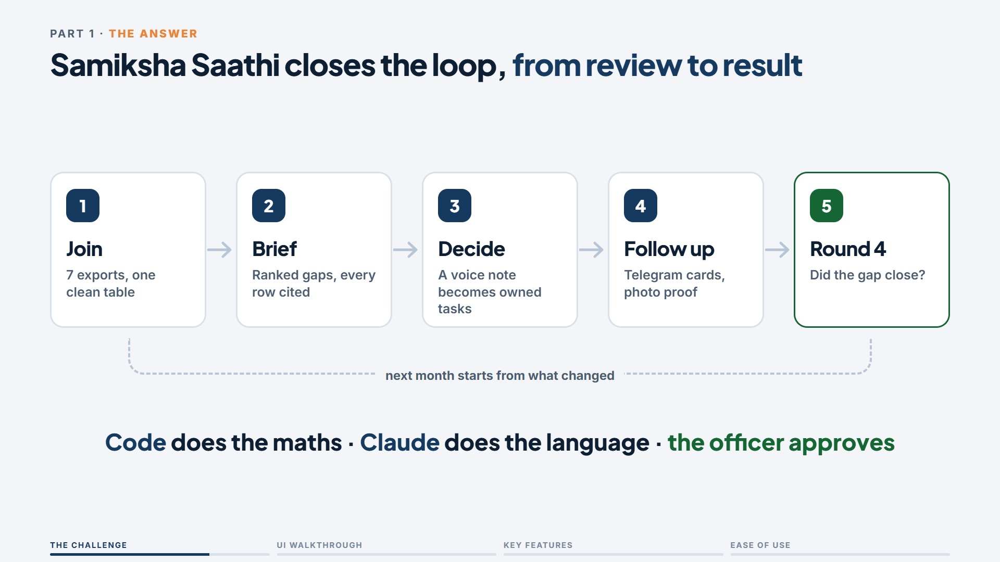
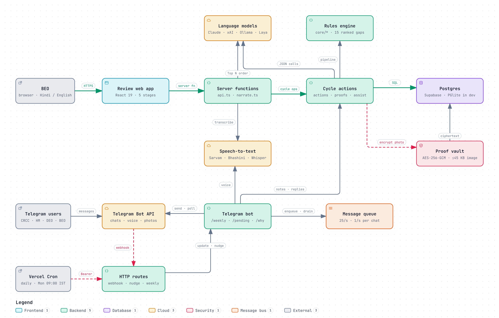

# Samiksha Saathi · समीक्षा साथी

**An AI helper for the block officer's monthly education review.**
AI for Foundational Learning Hackathon · Challenge 04: Data to Action · Nikhil Chawla, Team StarForce

Scattered exports go in. Out come a review agenda with every number checked, Telegram tasks that someone owns, photo proof, and an answer to one question: did the learning gap close?

## Demo video (3 min)

[](docs/media/samiksha-saathi-demo.mp4)

▶ [Watch `docs/media/samiksha-saathi-demo.mp4`](docs/media/samiksha-saathi-demo.mp4) (1080p, 3:00)

| Time | Section |
|---|---|
| 0:00 | The challenge: 7 exports, 3–4 days of joining by hand |
| 0:17 | The loop: Join → Brief → Decide → Follow up → Round 4 |
| 0:29 | Who uses it: BEO, CRCCs and headteachers, DEO and SPD |
| 0:37 | Walkthrough of the review app, the send gate, Telegram follow-up, photo proof and Round 4 |
| 2:16 | Key features, matched to each gap in the challenge |
| 2:40 | Ease of use: Hindi in one tap, speak instead of type, no login on Telegram, offline |

The submission deck is in [`Samiksha_Saathi_Final_Submission_Deck.pdf`](Samiksha_Saathi_Final_Submission_Deck.pdf) ([`.pptx`](Samiksha_Saathi_Final_Submission_Deck.pptx)).

## The problem

- Joining UDISE+, attendance and assessment files takes a district office **3–4 days**, and a 3-year trend another week (Challenge 04 video).
- In an MP school-management programme, **93%** of schools completed assessments, yet learning stayed flat: officials saw them as "only a data collection exercise" (J-PAL, 5,435 schools).
- Nationally, only **55%** of Grade 3 children can arrange numbers up to 99 (PARAKH 2024) and **27.1%** can read a Grade 2 text (ASER 2024).

The missing piece is follow-through, not more data.

## What it does

1. **Join and validate** — seven CSV or Excel exports, in MP, UP, PB or HR layouts, joined in under 0.1 s. Files with student data are refused.
2. **One-page brief** — the Top 5 / 10 / 15 gaps, with every number computed by code and cited to a file and row. An election-duty excuse is tested against peer blocks.
3. **Decide and approve** — the officer's spoken or typed note becomes draft tasks with an owner, a due date and a success measure. Nothing is sent until a BEO approves it.
4. **Field follow-up** — task cards (~320 bytes) go to CRCCs and headteachers on Telegram, with 09:00 IST reminders. Replies in Hindi or Hinglish update the task; classroom photos are checked on the server and stored encrypted.
5. **Round 4 scorecard** — did the schools that acted move more than similar schools that didn't?

## Architecture



Two ways in, one approval gate. The BEO works in the web review app; field staff and the daily cron come in through the Telegram bot. Both call the same cycle actions, which use:

| Layer | What it does | Network |
|---|---|---|
| 1 · Data input | Reads the exports, refuses personal data, cuts out injected instructions | none |
| 2 · Code + Laya rules | Joins, cleans and computes every gap; writes the brief | none |
| 3 · Model + speech | Claude (`claude-sonnet-5`, xAI fallback) reorders and reads unclear text; Sarvam, Bhashini or Whisper for voice. Capped per block per month; never computes a number | only when rules miss, or on a click |
| 4 · Guardrails | Five-way Laya check on every reorder, fact-check before sending, server re-check of stored photos | none |
| 5 · Human approval | A level-3 officer approves; a Postgres trigger checks the role again; a paced queue sends (25 msg/s, 1/s per chat) | only to send |

Stack: TanStack Start (React 19) · TypeScript engine (`src/lib/samiksha/core`) · Postgres on Supabase (in-memory PGlite in dev) · Telegram bot (`server/bot/telegram.ts`) · Vercel Cron.

## Run it locally

Needs Node 22.

```bash
npm install
cp .env.example .env.local   # optional: every variable can stay empty
npm run dev                  # http://localhost:8080
```

With no keys set, the app still runs end to end: an in-memory database, the code ranking instead of Claude's reorder, typed notes or browser speech instead of server speech-to-text, and task cards kept in the in-app action register instead of Telegram. [`.env.example`](.env.example) explains what each variable switches on; [`docs/RUNBOOK.md`](docs/RUNBOOK.md) covers Telegram, the Laya sidecar and deploying to Vercel.

> `npm run build` also runs the database migrations against `DATABASE_URL`.

## Deploy on Render

[`render.yaml`](render.yaml) is a Render Blueprint: in the Render dashboard choose **New → Blueprint**, pick this repo, and fill in the keys it asks for. `DATABASE_URL` is required there (for Supabase, the pooled URL ending in `?sslmode=no-verify`); the others are optional. Render generates the session, cron and webhook secrets itself. Without `DATABASE_URL` the app starts the in-memory PGlite demo database, which needs about 900 MB and runs out of memory on Render's 512 MB free and starter instances.

## Tests

```bash
npm run typecheck                # 0 errors
npm test                         # 133 TypeScript tests, then the app-builder template's script tests
npm run test:flow                # 64 end-to-end checks of the Telegram loop on a fresh database
npm run docs:report -- --check   # the reports' code citations still point at the right lines
```

Typecheck clean, 133/133 TypeScript tests, 64/64 flow checks, all 162 report citations current. On Windows, 10 of the template's 197 script tests fail: 2 need symlink rights (admin or Developer Mode), and 8 expect the template's default share-card name rather than this app's.

Highlights: Claude + Laya read 12/12 Hinglish field replies (rules alone: 4/12); 313 blocks, the size of Madhya Pradesh, run in under 2.5 s; a whole cycle runs offline with zero network calls. Model cost: ₹102.51 per block a month.

## Repository layout

| Path | Contents |
|---|---|
| `src/lib/samiksha/core/` | The engine: ingest, pipeline, guards, Laya rules, scorecard, cost model |
| `src/components/samiksha/` | The five-step review app |
| `src/server/samiksha/`, `src/routes/api/` | Server functions, webhook and cron routes |
| `server/bot/` | Telegram bot |
| `migrations/` | Postgres schema, row-level security, approval role trigger |
| `scripts/` | Flow checks, migrations, report renderer, reply eval |
| `docs/` | Architecture report, deck evidence, runbook, demo video |
